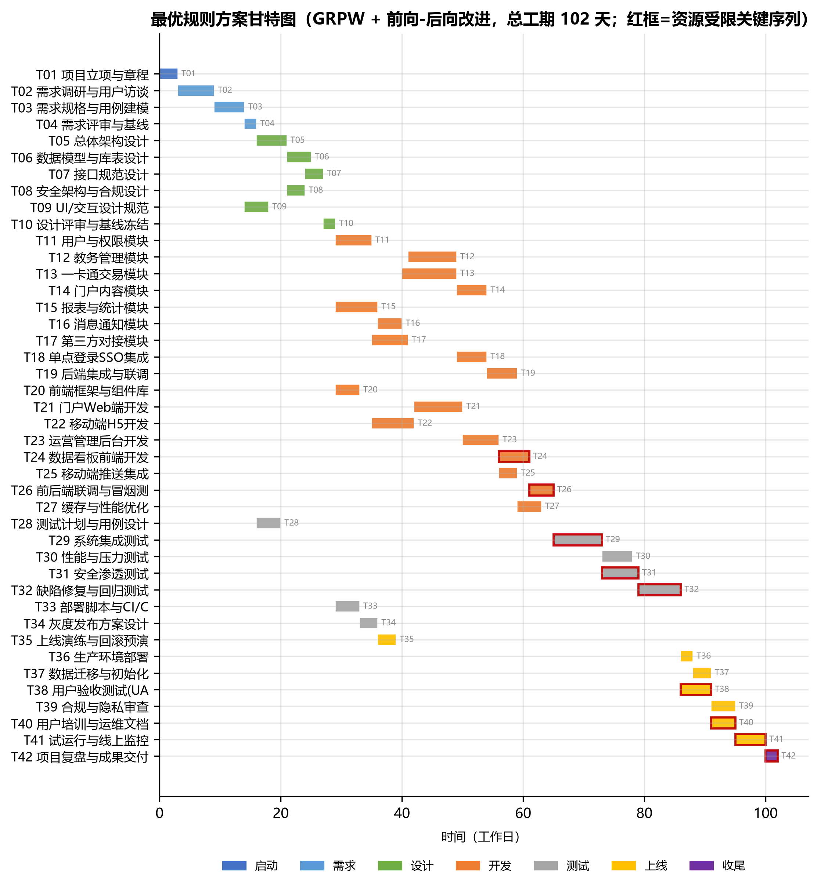

# 资源受限下软件项目调度的启发式算法设计与优化

> 《软件工程管理》课程作业 **题目 3**：资源受限下软件项目调度 RCPSP 的启发式算法优化

本项目以**资源受限项目调度（RCPSP）**为理论框架，对一个 42 个任务、71 条依赖、10 类研发角色的软件项目案例进行建模、求解与对比实验，实现了 8 种启发式优先规则、2 种调度生成机制、前向—后向改进算法与随机键多起点搜索，并自动生成全部图表与论文报告。



---

## 目录

- [一、项目解决了什么问题](#一项目解决了什么问题)
- [二、核心结论](#二核心结论)
- [三、快速开始](#三快速开始)
- [四、命令行用法](#四命令行用法)
- [五、目录结构](#五目录结构)
- [六、算法与模型](#六算法与模型)
- [七、数据集](#七数据集)
- [八、测试](#八测试)
- [九、报告文档](#九报告文档)
- [十、参考引用](#十参考引用)

---

## 一、项目解决了什么问题

关键路径法（CPM）假设资源无限，给出的“理论最快工期”在真实团队中往往做不到——因为同一批工程师被并行分配到多个模块。

本项目回答四个问题：

| 问题 | 对应实现 |
| --- | --- |
| 如何把一个软件项目形式化成 RCPSP 实例？ | `data/` 三张 CSV + `src/rcpsp/project.py` |
| 资源冲突到底出现在哪、有多严重？ | `metrics.resource_conflict_report` + 冲突识别图 |
| 不同优先规则差多少？哪种更好？ | 8 种规则 × 2 种 SGS 的完整对比实验 |
| 还能优化多少？小团队的实践局限是什么？ | 前向—后向改进 + 随机键搜索 + 报告第 6 章 |

## 二、核心结论

| 指标 | 结果 |
| --- | --- |
| 无资源约束工期（CPM） | **84 个工作日**（关键路径 18 个任务） |
| 最优启发式调度工期 | **102 个工作日**（GRPW / LFT / LST / MTS 并列） |
| 资源约束的代价 | **+18 天，+21.4%** |
| 8 种规则的工期极差 | 12 天（102 ~ 114 天，11.8%） |
| 前向—后向改进的收益 | 平均 **-2.25 天（1.9%）**，把规则极差压缩到 5 天 |
| 与 400 次随机搜索最好解的差距 | **0 天**（已达可达最优） |
| 最严重的资源冲突 | 后端峰值需求 13 人 / 容量 4 人（3.25 倍） |
| 瓶颈角色 | 前端开发，利用率 33.8% |
| 前端加人的边际收益 | 2→3 人省 2 天；4 人以上无收益 |

## 三、快速开始

```bash
# 1. 克隆
git clone https://github.com/2673974951/software_project_work_LZR.git
cd software_project_work_LZR

# 2. 建虚拟环境
python -m venv .venv
.venv\Scripts\activate        # Windows
source .venv/bin/activate     # macOS / Linux

# 3. 安装依赖
pip install -r requirements.txt
pip install -e .              # 可选：安装命令行工具 rcpsp

# 4. 一键复现全部结果与图表（约 10 秒）
python scripts/run_experiment.py
```

运行后产生：

- `outputs/` —— 9 张 CSV 结果表与 `summary.md` 结论摘要
- `docs/figures/` —— 9 张 300 dpi 图表

## 四、命令行用法

安装后可直接使用 `rcpsp` 命令（或 `python -m rcpsp`）：

```bash
rcpsp info                        # 实例概况 + 资源冲突识别
rcpsp cpm                         # 无资源约束的关键路径
rcpsp schedule --rule GRPW        # 按指定规则排一次（打印调度表与利用率）
rcpsp schedule --rule SPT --parallel --improve
rcpsp compare                     # 8 种规则在两种 SGS 下的对比
rcpsp compare --improve           # 叠加前向-后向改进
rcpsp capacity --role FE          # 前端人力容量敏感性
rcpsp all                         # 等价于 scripts/run_experiment.py
```

也可以在自己的代码里调用：

```python
from rcpsp.project import load_project
from rcpsp.metrics import compare_rules, resource_utilisation_table
from rcpsp.sgs import schedule_with_rule, double_justify

proj = load_project("data")
best = double_justify(proj, schedule_with_rule(proj, "GRPW"))[0]
print("总工期：", best.makespan)
for row in resource_utilisation_table(proj, best):
    print(row["role_id"], "利用率 %.1f%%" % (100 * row["utilisation"]))
```

## 五、目录结构

```
software_project_work_LZR/
├── data/                     实例数据（可直接替换为自己的项目）
│   ├── tasks.csv             任务、工期、紧前关系
│   ├── resources.csv         角色与容量
│   ├── task_resources.csv    任务对各角色的需求
│   └── README.md             数据字段与假设说明
├── src/rcpsp/
│   ├── project.py            数据模型、CSV 载入、DAG 校验、下界估计
│   ├── cpm.py                关键路径法（无资源约束基准）
│   ├── rules.py              8 种优先规则
│   ├── sgs.py                串行/并行 SGS、前向-后向改进、随机键搜索
│   ├── metrics.py            利用率、冲突识别、方案对比、关键序列
│   ├── plotting.py           9 张图表
│   └── cli.py                命令行入口
├── scripts/
│   ├── run_experiment.py     一键复现实验与图表
│   └── build_report.py       Markdown → Word 排版脚本
├── tests/                    34 个单元测试
├── docs/
│   ├── report.md             论文报告源文件（Markdown）
│   └── figures/              全部图表
├── report/                   Word / PDF 交付件
├── outputs/                  运行结果（CSV + 摘要）
├── requirements.txt
└── pyproject.toml
```

## 六、算法与模型

### 6.1 模型

在紧前关系约束与资源容量约束下最小化总工期：

```
min  C_max = max_j ( S_j + d_j )
s.t. S_j >= S_i + d_i          for all i in P(j)      （依赖约束）
     sum{ q_jk } <= b_k        对所有时刻 t 与资源 k    （资源约束）
     任务非抢占、工期固定、资源需求恒定
```

### 6.2 算法栈（分四层，可独立开关）

| 层 | 内容 | 实现 |
| --- | --- | --- |
| 1 | 优先规则：LFT / LST / MSLK / SPT / MTS / GRPW / SRD / RANDOM | `rules.py` |
| 2 | 调度生成机制：串行 SGS、并行 SGS | `sgs.py` |
| 3 | 前向—后向改进（double justification） | `sgs.double_justify` |
| 4 | 随机键多起点搜索（解质量参照系） | `sgs.random_multistart` |

### 6.3 优先规则一览

| 代码 | 名称 | 信息来源 | 说明 |
| --- | --- | --- | --- |
| LFT | 最晚完成时间优先 | 关键路径 | 关键路径优先的经典实现 |
| LST | 最晚开始时间优先 | 关键路径 | 对长任务更敏感 |
| MSLK | 最小时差优先 | 时差 | 最怕被推迟的先做 |
| SPT | 最短工期优先 | 工期 | 快速清空小任务 |
| MTS | 最多后继任务优先 | 网络结构 | 解锁下游最多者优先 |
| GRPW | 最大秩位权优先 | 网络结构 | 自身工期 + 全部后继工期 |
| SRD | 资源需求强度优先 | 资源占用 | 占用比例最高者优先 |
| RANDOM | 随机优先序列 | — | 对照基线 |

## 七、数据集

`data/` 下三张 CSV 描述一个完整的 RCPSP 实例，替换为自己的项目数据即可直接使用：

- **42 个任务**，分 7 个阶段（启动/需求/设计/开发/测试/上线/收尾）
- **71 条紧前关系**
- **10 类研发角色**，共 20 人
- **总工作量 422 人日**
- 无资源约束工期 84 天，资源受限最优工期 102 天

字段说明与建模假设见 [`data/README.md`](data/README.md)。

## 八、测试

```bash
pytest tests -v
```

34 个单元测试覆盖：

- 数据模型与 DAG 校验（环检测、未知前置、需求超容量）
- CPM 的手算可验证网络
- 优先规则的性质（SPT 按工期排序、LFT 关键任务优先、传递后继计数）
- **调度可行性**（依赖约束、资源容量）对全部 8 种规则 × 2 种 SGS
- **活动调度性质**（没有任务可以在不违反约束的前提下更早开工）
- 前向—后向改进的单调性（不会变差）
- 随机搜索的可复现性
- 资源冲突识别与利用率计算

## 九、报告文档

| 文件 | 说明 |
| --- | --- |
| `docs/report.md` | 论文报告 Markdown 源文件（GitHub 可直接阅读） |
| `report/*.docx` | Word 交付件（含封面、图表编号、参考文献） |
| `report/*.pdf` | PDF 交付件 |

重新生成 Word / PDF：

```bash
python scripts/build_report.py     # 生成 report/*.docx
# 用 Word 或 LibreOffice 将 docx 另存为 pdf
```

## 十、参考引用

1. Pritsker A A B, Watters L J, Wolfe P M. Multiproject scheduling with limited resources. *Management Science*, 1969.
2. Blazewicz J, Lenstra J K, Rinnooy Kan A H G. Scheduling subject to resource constraints. *Discrete Applied Mathematics*, 1983.
3. Kolisch R. Serial and parallel resource-constrained project scheduling methods revisited. *EJOR*, 1996.
4. Kolisch R, Sprecher A. PSPLIB — A project scheduling problem library. *EJOR*, 1997.
5. Valls V, Ballestín F, Quintanilla S. Justification and RCPSP: A technique that pays. *EJOR*, 2005.
6. Demeulemeester E L, Herroelen W S. *Project Scheduling: A Research Handbook*. Kluwer, 2002.

完整参考文献见报告第 8 节。

---

## 许可

MIT License，详见 [LICENSE](LICENSE)。
