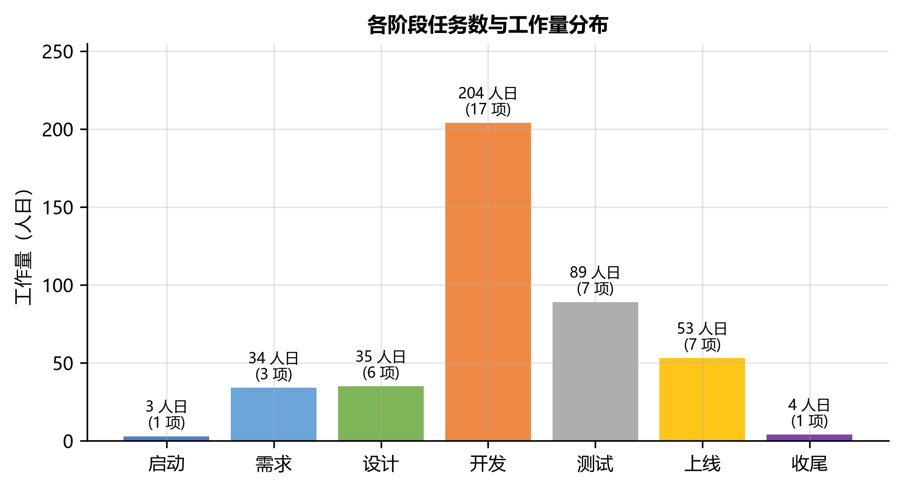
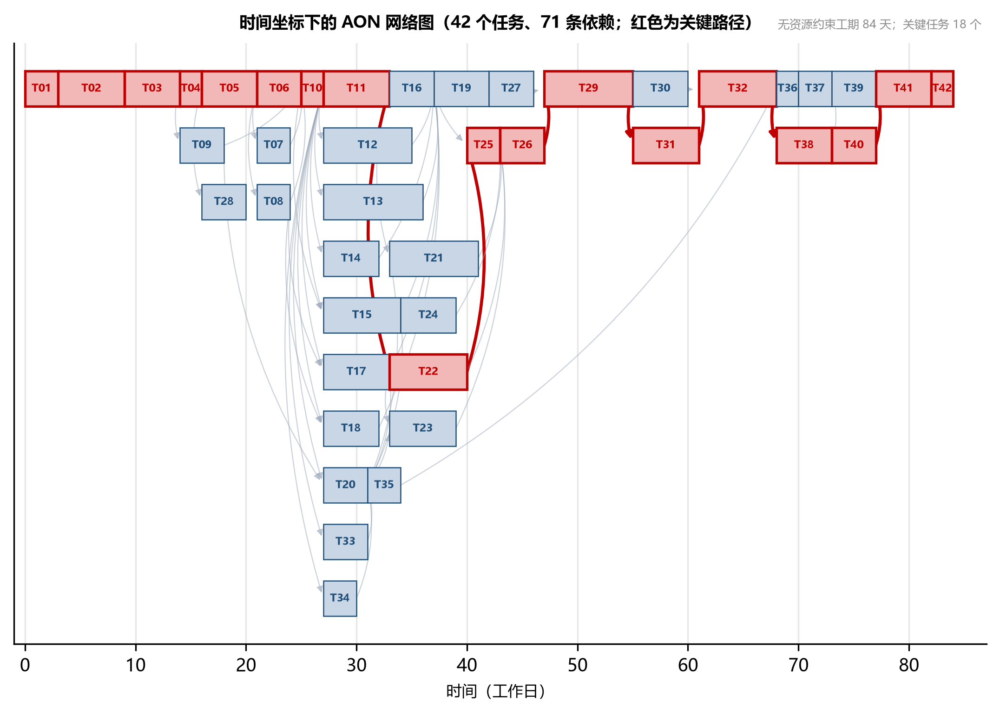
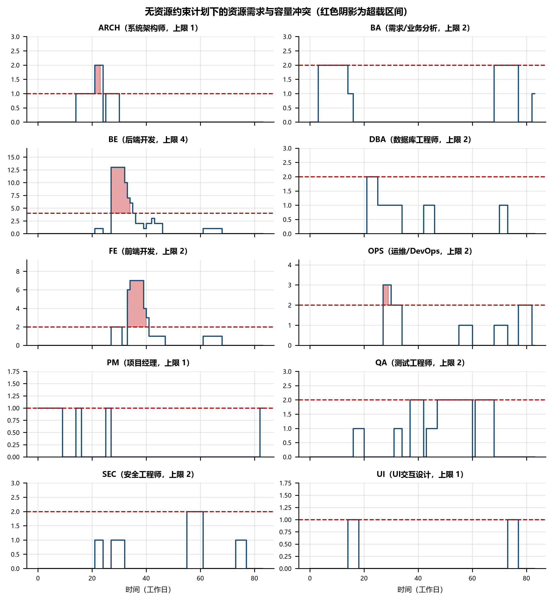
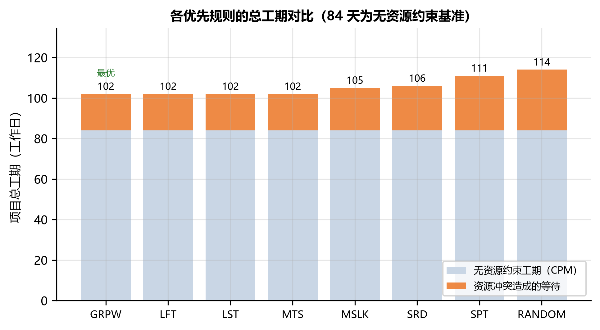
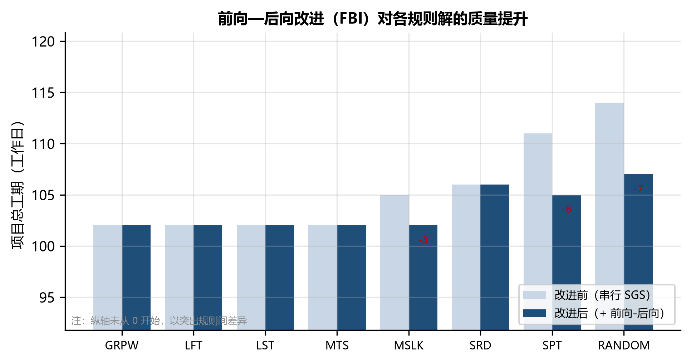
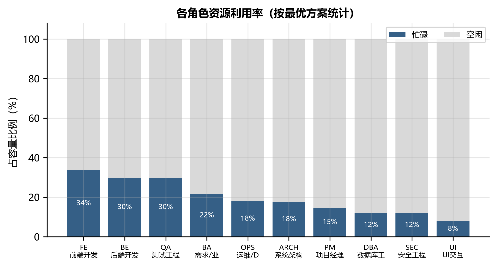
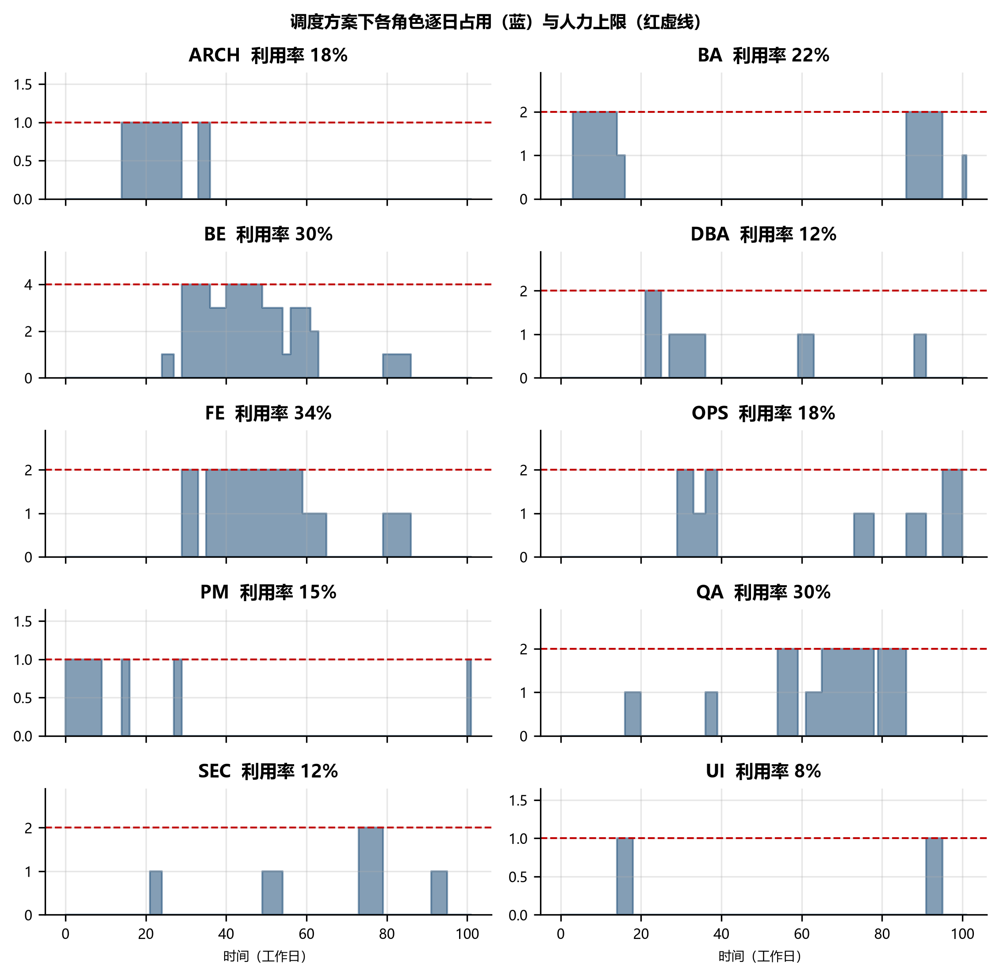
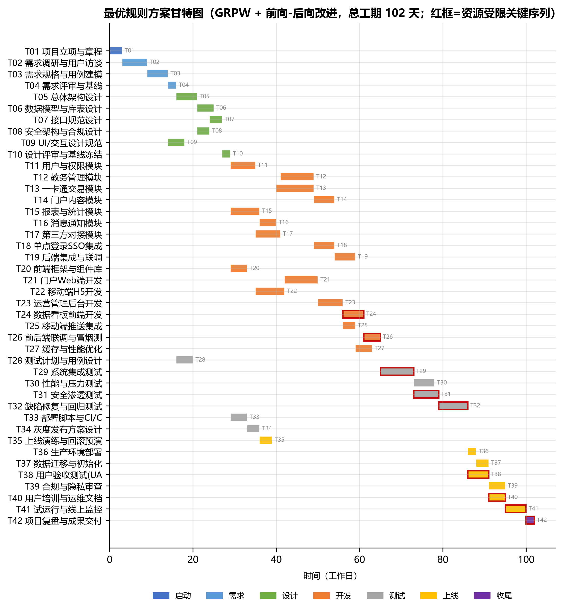
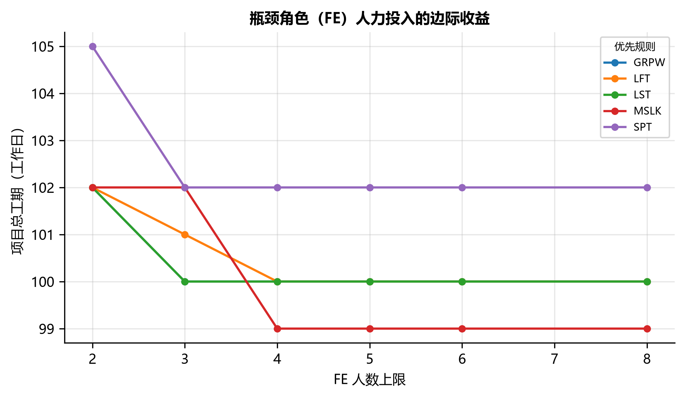

# 资源受限下软件项目调度的启发式算法设计与优化

**——以“智慧校园综合服务平台 v2.0”为例**

---

## 摘要

软件项目最核心的资源是研发人员，而人力冲突几乎是所有中小型团队进度失控的首要原因：同一个后端工程师被并行分配到多个模块，关键路径法（CPM）给出的“理论最快工期”在现实中根本无法实现。本文以资源受限项目调度（RCPSP）为理论框架，对一个 42 个任务、71 条依赖关系、10 类研发角色的真实规模软件项目案例进行建模与求解。

本文首先用 CPM 给出无资源约束的理论基准——84 个工作日；随后构造“按依赖尽早开工”的理想进度，逐日累加各角色的需求并与容量比对，量化识别出资源冲突的分布：后端开发峰值需求 13 人而容量仅 4 人（3.25 倍超载，超载 8 天），前端开发峰值需求 7 人而容量仅 2 人（3.5 倍超载，超载 8 天），系统架构师与运维也有轻度超载。这说明该实例的瓶颈不在依赖关系，而在人力。

在算法层面，本文实现了 8 种经典优先规则（LFT、LST、MSLK、SPT、MTS、GRPW、SRD 与随机基线）、2 种调度生成机制（串行 SGS 与并行 SGS），并在此基础上叠加了前向—后向改进（Forward-Backward Improvement, FBI）与 400 次随机键多起点搜索。实验得到四个层面的结果：

第一，资源约束使工期从 84 天延长到 102 天（+18 天，+21.4%），这 18 天是“资源等待”，任何优先规则都无法消除，只能通过增加人力或重构依赖来压缩。

第二，8 种规则的工期分布在 102 至 114 天之间，极差 12 天（11.8%）。LFT、LST、MTS、GRPW 四条“看关键路径或看网络结构”的规则并列最优（102 天）；最短工期优先（SPT）退化到 111 天，随机基线最差（114 天），说明“短任务先做”在这类多分支竞争的场景中是一种典型的短视行为。

第三，前向—后向改进把规则间的极差从 12 天压缩到 5 天，平均缩短 2.00 天（1.9%），且对最差的规则改善最大（随机基线从 114 天降到 107 天）。这一结论对小团队有直接价值：当团队没有精力精细挑选优先规则时，把改进算法接在任意一个规则之后，就能把“选错规则”的代价压到很小。

第四，400 次随机键搜索的最好解同样是 102 天，与最优规则的解只差 0 天，说明启发式规则在该实例上已经达到（或非常接近）最优，进一步优化的空间极小。

在资源利用率方面，最优方案下前端开发利用率最高（33.8%）、其后是后端（29.9%）与测试（29.9%），UI 设计最低（7.8%）。容量敏感性实验显示：前端从 2 人增至 3 人可使工期缩短 2 天，增至 4 人后再无收益，即**前端的最优配置是 3 人**。

本文最后讨论了各规则的适用场景与优缺点，并结合小型研发团队的现实约束（一人多角色、任务不可分割、估算粗糙、切换成本高）分析了模型的实践局限。

**关键词**：资源受限项目调度；RCPSP；启发式算法；优先规则；调度生成机制；串行 SGS；前向—后向改进；软件项目管理

---

## 1 绪论

### 1.1 研究背景

关键路径法（CPM）是软件项目进度管理最常用的工具。它假设资源无限：只要一个任务的前置任务完成了，第二天就可以开工。这个假设在纸面上让问题变得干净——最长路径就是项目工期——但在真实团队里几乎从不成立。

一个典型的中小型研发团队有 5 到 20 人，按角色划分成产品、架构、后端、前端、测试、运维几类。项目进行到开发阶段时，往往有七八个模块同时“具备开工条件”，而后端只有三四个人。此时的问题不再是“最长路径有多长”，而是**在人力上限与依赖关系的双重约束下，先做哪个、后做哪个，总工期才最短**。这就是资源受限项目调度（Resource-Constrained Project Scheduling Problem, RCPSP）。

软件项目的 RCPSP 还有一个特殊性：任务不可分割。一个后端模块很难“今天做一半换别人做另一半”，也不适合被两个工程师同时写同一份代码（沟通成本会抵消并行收益，即 Brooks 定律[15]）。因此 RCPSP 的“非抢占、资源需求恒定、工期固定”三条经典假设，在软件场景下反而是**贴切的**，这为把运筹学方法直接迁移到软件项目管理提供了依据。

### 1.2 问题定义与研究任务

本文要回答四个问题：

1. **建模问题**：如何把一个软件项目的任务、依赖、人力需求与人力上限，形式化成一个可计算的 RCPSP 实例？
2. **冲突问题**：在没有资源约束的理想进度中，究竟哪些角色、在哪些时段、超出容量多少？这是资源受限必要性的证据。
3. **算法问题**：实现多种启发式优先规则与调度生成机制，它们的工期差距有多大？哪种规则在什么条件下更好？
4. **优化与局限问题**：在规则解之上还能改进多少？这些方法在小型研发团队中的实践局限是什么？

### 1.3 国内外研究现状

**模型与复杂度。** RCPSP 的标准形式化可以追溯到 20 世纪 60 年代末，此后被广泛采用。经过半个多世纪的发展，其变体与扩展已形成庞大体系：Hartmann 与 Briskorn 的更新综述系统梳理了随机工期、多模式、多技能、多项目等上百种变体[5]。就计算复杂度而言，Blazewicz 等证明该问题是强 NP-hard[2]，这意味着 30 个任务以上的实例基本不可能用精确算法在可接受时间内求解。

**精确算法与基准库。** 早期的分支定界方法可以在 PSPLIB 的 J30 实例集（30 个任务）上求得最优解，但对 J60 与 J120 则难以在合理时间内完成。PSPLIB 长期作为评价启发式算法性能的公共基准；针对近年兴起的多技能扩展形式，Snauwaert 与 Vanhoucke 重新做了问题分类并给出了新的基准实例集[7]，使"人不仅能干一种活"这一现实约束也能被标准化地评测。

**启发式方法。** 工程实践的主流是"优先规则 + 调度生成机制"。Kolisch 系统比较了串行与并行调度生成机制[3]，指出串行 SGS 生成的调度一定是活动调度（active schedule），其解空间包含最优解，而并行 SGS 生成的只是非延迟调度（non-delay schedule），解空间是前者的子集。

**元启发式与改进技术。** 在优先规则之上，研究者发展了遗传算法、模拟退火、禁忌搜索、蚁群算法等方法。Pellerin 等对 300 余篇文献做了系统梳理，指出混合元启发式在该问题上的主流地位与实现要点[6]。近年一个值得注意的方向是把多条优先规则"集成"起来——Đumić 与 Jakobović 用进化方法自动组合基础规则，在 PSPLIB 上稳定优于任何单条规则[8]。与此同时，Valls 等提出的**前向—后向改进**（double justification）[4]因其极低的计算成本被沿用至今，并在 relax-and-solve 等新求解框架中继续承担"解的抛光"角色[9]。

**软件项目场景的落地。** 国内软件工程管理教材已引入资源平衡与资源平滑的概念，但多停留在"手工调整甘特图"的层面[13]；PMI 的 PMBOK 第 7 版把进度管理的落脚点从"活动清单"转向"可交付成果"[10]，《职业脉搏》2024 年度报告则指出人力资源调配与跨团队协同是当前项目交付最主要的压力来源[11]；国家标准 GB/T 8566—2022 规定了软件生存周期过程，为"阶段—活动"的划分提供了规范依据[12]。这些工作共同说明：进度管理的难点已经从"画出一条路径"转向"在有限人力下排出可行且可解释的顺序"。

### 1.4 研究内容与技术路线

技术路线分四步：

1. **建模**：WBS 分解得到 42 个任务，确定 71 条紧前关系，为每个任务标注各角色的需求人数，为每个角色设定容量上限。
2. **基准与冲突诊断**：用 CPM 求无资源约束工期作为下界；用“按依赖尽早开工”的理想进度诊断资源冲突。
3. **启发式求解**：实现 8 种优先规则 × 2 种调度生成机制；再叠加前向—后向改进与随机键多起点搜索。
4. **对比与分析**：从总工期、资源利用率、调度甘特图、容量敏感性四个维度对比，并讨论适用场景与实践局限。

### 1.5 主要工作与贡献

- 构建了一个**规模真实、冲突显著**的软件项目 RCPSP 实例（42 任务、10 角色、71 条依赖），并给出了完整的资源冲突量化方法。
- 实现了 **8 种优先规则 + 2 种调度生成机制 + 前向—后向改进 + 随机键搜索**的完整算法栈，全部带中文注释与单元测试（34 个测试用例，覆盖调度可行性、活动调度性质、改进单调性等关键不变量）。
- 得到一组**有管理含义的结论**：资源约束的代价是 +21.4%；规则之间的极差可达 11.8%；前向—后向改进能把极差压缩到 4.9%；启发式解已达到随机搜索的最好解。
- 全部实验由一条命令复现，随机种子固定，图表自动生成。

---

## 2 RCPSP 理论基础

### 2.1 问题描述与数学模型

设有 n 个任务，任务 j 的工期为 d_j，紧前任务集合为 P(j)。有 K 类可再生资源，资源 k 的容量为 b_k，任务 j 对资源 k 的需求为 q_jk（在任务执行期间恒定）。求各任务的开工时间 S_j，使总工期最小：

    目标：min C_max = max_j ( S_j + d_j )

    约束 1（紧前关系）：S_j >= S_i + d_i，对任意 i 属于 P(j)
    约束 2（资源容量）：对任意时刻 t 与任意资源 k，
              sum{ q_jk : S_j <= t < S_j + d_j } <= b_k
    约束 3（非抢占）：任务一旦开工必须连续执行到结束

约束 2 是 RCPSP 与 CPM 的唯一本质区别。CPM 只有约束 1，因此可以解析地求出最长路径；加入约束 2 之后，“最长路径”不再决定工期，因为两个不在同一条路径上的任务可能同时在抢同一批人。

### 2.2 复杂度与求解思路

Blazewicz 等证明该问题是强 NP-hard[2]。直观理解：若忽略资源约束，问题是多项式时间的 CPM；一旦加入资源约束，任务的排序问题就叠加上了“装箱”结构，组合爆炸。

三类求解思路：

**表1 三类求解方法的对比**

| 思路 | 代表方法 | 适用规模 | 特点 |
| --- | --- | --- | --- |
| 精确算法 | 分支定界、整数规划 | 30 个任务以内 | 可证最优，但规模一大就不可行 |
| 启发式 | 优先规则 + SGS | 数百个任务 | 秒级求解，解质量 5% 以内 |
| 元启发式 | 遗传、禁忌、模拟退火 | 数百个任务 | 解质量更好，但参数多、耗时长 |

本文选择启发式路线，理由有二：一是软件项目的实际规模（几十到上百个任务）恰好落在启发式的甜点区；二是启发式的解**可解释**——每个任务的先后顺序都能对应到一条业务规则，便于向团队解释和落地，而元启发式的解往往难以说明“为什么这样排”。

### 2.3 解空间：活动调度与非延迟调度

调度方案的质量取决于搜索空间。三个经典定义：

- **半活动调度**：不存在“可以在不改变其他任务开工时间的前提下提前”的任务。
- **活动调度**：不存在“可以在不推迟任何其他任务的前提下整体提前”的任务。活动调度集合是半活动调度集合的子集，且**必包含至少一个最优解**。
- **非延迟调度**：不存在“某资源空闲、且有无任务本可以开工”的情形。非延迟调度集合又是活动调度集合的子集。

结论：**串行 SGS 生成活动调度，并行 SGS 生成非延迟调度**。由于后者是前者的子集，并行的全局最优不可能优于串行。这是本文实验要验证的第一个理论命题。

### 2.4 调度生成机制

**串行 SGS** 的伪代码：

    已调度集合 S = 空
    当 S 不等于全部任务：
        从"紧前任务都在 S 中"的任务里，按优先规则选出最优者 j
        t = max{ EF_i : i 属于 P(j) }            # 满足依赖的最早时刻
        当 [t, t + d_j) 区间内任一资源超容量：t = t + 1
        安排 j 在 t 开工，更新资源占用曲线
        S = S 并上 {j}

**并行 SGS** 的伪代码：

    t = 0
    当仍有任务未调度：
        把"紧前任务全部完成、且当前时刻资源余量足够"的任务按优先规则排序
        依次尝试开工（资源够就开工，不够就等）
        t = t + 1

两者的关键差别在于：串行 SGS 是**按任务推进**（一次决定一个任务放在哪天），并行 SGS 是**按时间推进**（一次决定某天能开哪些任务）。串行 SGS 在放置一个任务时会检查它整段工期内的资源可行性，因此不会留下“资源被占用但任务无法完成”的空洞；并行 SGS 只检查当前时刻，容易形成无法被后续任务填充的碎片。

### 2.5 优先规则

优先规则是 SGS 的“打分函数”。按信息来源可分为五类：

- **基于关键路径**：LFT（最晚完成时间）、LST（最晚开始时间）。直觉是“越接近截止期限的任务越先做”。
- **基于时差**：MSLK（最小时差）。时差越小，越经不起推迟。
- **基于工期**：SPT（最短工期优先）。希望快速清空任务、尽早释放资源。
- **基于网络结构**：MTS（最多传递后继）、GRPW（最大秩位权，即自身工期加全部后继工期之和）。衡量“这个任务能解锁多少下游工作”。
- **基于资源占用**：SRD（资源需求强度，即占用各资源容量比例之和）。占用越多越难安排，先排它。

此外必须设置**随机基线**（RANDOM），否则无法判断“规则是否真的有用”——如果随机排序也能得到同样好的解，规则的价值就值得怀疑。

### 2.6 下界与解质量评价

判断启发式解的好坏需要下界。本文使用两个：

1. **CPM 下界**：无资源约束的最短工期，任何 RCPSP 解都不可能低于它。
2. **工作量下界**：对资源 k，项目总工期不可能小于

       sum_j ( q_jk * d_j ) / b_k

   因为该资源的总工作量必须在“任意时刻不超过 b_k”的前提下清完。

综合下界取二者最大值。本案例中 CPM 为 84 天，工作量下界为 34.5 天（前端），故综合下界为 84 天，由 CPM 决定——这说明瓶颈是结构性约束（依赖关系）而非纯工作量。

---

## 3 案例项目建模

### 3.1 项目概况

案例为“智慧校园综合服务平台 v2.0”，是在既有校园门户基础上升级的综合业务系统，包含教务管理、一卡通交易、门户内容与移动端三大业务线，并配套运营管理后台与数据看板。团队共 20 人：

**表2 团队角色与人数配置**

| 角色 | 名称 | 人数 |
| --- | --- | --- |
| PM | 项目经理 | 1 |
| BA | 需求/业务分析 | 2 |
| ARCH | 系统架构师 | 1 |
| DBA | 数据库工程师 | 2 |
| UI | UI 交互设计 | 1 |
| BE | 后端开发 | 4 |
| FE | 前端开发 | 2 |
| QA | 测试工程师 | 2 |
| SEC | 安全工程师 | 2 |
| OPS | 运维/DevOps | 2 |

选择这一规模的理由是：它足够大（42 个任务）以体现资源竞争的复杂性，又足够小（20 人）符合“中小型研发团队”的典型画像；同时它的业务线是**三条相对独立、又最终汇聚**的结构，这正是 RCPSP 最能体现价值的网络形态。

需要说明：案例数据为**教学案例数据**，基于同类校企合作项目的工作量比例设定，并非某企业的实际工时记录。第 6 章会把这一点作为方法局限明确讨论。

### 3.2 WBS 分解

WBS 采用“阶段—工作包”两级分解，共 7 个阶段、42 个工作包：

**表3 各阶段任务数与工作量**

| 阶段 | 任务数 | 工作量（人日） | 说明 |
| --- | --- | --- | --- |
| 启动 | 1 | 3 | 立项与章程 |
| 需求 | 3 | 34 | 调研、规格、评审 |
| 设计 | 6 | 35 | 架构、数据、接口、安全、UI |
| 开发 | 17 | 204 | 公共基础 + 三条业务线 |
| 测试 | 7 | 89 | 用例、集成、性能、安全、回归 |
| 上线 | 7 | 53 | 演练、部署、迁移、验收、合规、培训、试运行 |
| 收尾 | 1 | 4 | 复盘与交付 |
| 合计 | 42 | 422 | — |

开发阶段占全部工作量的 48%（204/422），是资源冲突的主战场，也是 RCPSP 发挥作用的主要空间。

### 3.3 依赖关系与网络结构

42 个任务之间共定义 71 条紧前关系，整体是一张“先串行、后展开、再收拢”的 AON 网络。

图2 按“最长前驱链长度”把 42 个任务分成 15 层，同层任务横向排列、层自上而下推进，红色节点与红色箭头标出关键路径。可以看到前 6 层是一条单链（T01 至 T06、T10），此后网络在第 7、8 层迅速展开成三条业务线并行、又在 T33 之后重新收拢成一串上线流程——展开段正是后文资源冲突最剧烈的区间。

网络有三个结构性特征，直接决定了调度的难度：

**特征一：公共基础层是必经之路。** T01 至 T10（立项、需求、设计）构成一条近乎线性的前置链，所有业务线都必须等它完成。这意味着前 27 天几乎没有调度自由度。

**特征二：三条业务线并行竞争资源。** 公共基础完成后，教务线（T11–T15）、一卡通线（T16–T21）、门户与移动线（T22–T28）同时具备开工条件，却共享同一批后端、前端、测试人员。这是资源冲突最剧烈的区间。

**特征三：多级汇聚点。** T19（后端联调）需要全部 8 个后端模块完成，T26（前后端联调）需要 4 条前端分支完成，T33 之后的集成测试需要三条线的测试全部完成。汇聚点的存在使得“某一条线拖后”会直接推迟整个项目。

无资源约束条件下，关键路径为

    T01 → T02 → T03 → T04 → T05 → T06 → T10 → T11 → T22 → T25 → T26
        → T29 → T31 → T32 → T38 → T40 → T41 → T42

共 18 个任务，总工期 84 个工作日。

### 3.4 人力资源需求

每个任务对各角色的需求以“人数”标注，且假定在整段工期内恒定。例如 T13（一卡通交易模块）工期 9 天，需要 2 名后端；T32（缺陷修复与回归）工期 7 天，需要 1 名后端、1 名前端、2 名测试。

全项目按角色统计的工作量与工作量下界见表4。

**表4 各角色工作量与需求分布**

| 角色 | 容量 | 承担任务数 | 总工作量（人日） | 工作量下界（天） |
| --- | --- | --- | --- | --- |
| PM | 1 | 5 | 15 | 15.0 |
| BA | 2 | 7 | 44 | 22.0 |
| ARCH | 1 | 6 | 18 | 18.0 |
| DBA | 2 | 5 | 24 | 12.0 |
| UI | 1 | 2 | 8 | 8.0 |
| BE | 4 | 14 | 122 | 30.5 |
| FE | 2 | 8 | 69 | 34.5 |
| QA | 2 | 7 | 61 | 30.5 |
| SEC | 2 | 4 | 24 | 12.0 |
| OPS | 2 | 7 | 37 | 18.5 |

单看工作量下界，前端（34.5 天）与后端（30.5 天）最紧张，但都远低于 CPM 的 84 天。这说明**总工期的约束力来自依赖关系，而不是单纯的劳动力总量**；资源冲突的作用是“在依赖给定的时间窗口内，把任务挤得更排队”，从而产生额外的等待。

### 3.5 资源冲突识别

这是本章最关键的一步：先证明“资源冲突真实存在且严重”，RCPSP 才有必要。

方法：按 CPM 的最早开始时间排出一份“理想进度”（假定资源无限），逐日累加各角色的需求，与容量比较。

**表5 无资源约束计划下的资源冲突识别**

表中“强度”指峰值需求与容量之比；“冲突天数”为 0 的角色即不存在超载。

| 角色 | 容量 | 峰值需求 | 冲突天数 | 最大超载 | 强度 | 冲突 |
| --- | --- | --- | --- | --- | --- | --- |
| BE 后端开发 | 4 | 13 | 8 | 9 | 3.25 |
| FE 前端开发 | 2 | 7 | 8 | 5 | 3.50 |
| ARCH 系统架构师 | 1 | 2 | 3 | 1 | 2.00 |
| OPS 运维/DevOps | 2 | 3 | 3 | 1 | 1.50 |
| BA / DBA / PM / QA / SEC / UI | — | 未超限 | 0 | 0 | 1.00 |

图3 把这张表可视化了：每个子图是一条“逐日需求曲线”，红色虚线是容量，红色阴影是超载区间。可以清楚看到：

- **后端**在第 27 至 35 天之间需求骤增到 13 人，而容量只有 4 人，缺口 9 人——这是三条业务线的后端模块同时“具备开工条件”造成的。
- **前端**在同一时段需求达到 7 人，容量 2 人，缺口 5 人，形成第二个瓶颈。
- 架构师、运维的超载幅度小（各 1 人、3 天），属于“可以靠微调解决”的轻度冲突。

一个值得强调的细节：**BA、DBA、PM、QA、SEC、UI 六个角色完全没有冲突**。这说明资源约束并不是“全面缺人”，而是**结构性错配**——忙的角色一直忙，闲的角色一直闲。这为第 5 章的利用率分析埋下伏笔，也为第 6 章的管理建议提供依据。

### 3.6 实例参数汇总

**表6 实例参数汇总**

| 参数 | 取值 |
| --- | --- |
| 任务数 | 42 |
| 依赖边数 | 71 |
| 资源（角色）种类 | 10 |
| 总人力投入 | 20 人 |
| 总工作量 | 422 人日 |
| 无资源约束工期（CPM） | 84 天 |
| 资源工作量下界 | 34.5 天（前端） |
| 冲突角色数 | 4 / 10 |
| 最大超载强度 | 3.50（前端） |

---

## 4 启发式算法设计

### 4.1 总体框架

本文的算法栈分为四层，每层都可独立开关，便于做消融对比：

    第 1 层  优先规则        → 给出任务排序（8 种）
    第 2 层  调度生成机制    → 把排序翻译成可行调度（串行 / 并行 SGS）
    第 3 层  前向—后向改进   → 在可行调度上做局部优化（FBI）
    第 4 层  随机键多起点    → 作为解质量参照（400 次随机重启）

这种分层设计的好处是：第 1、2 层解决“可行”，第 3 层解决“更好”，第 4 层回答“还有多少空间”。报告中的对比表因此可以逐层剥离，看清每一步的贡献。

### 4.2 优先规则设计

共实现 8 种规则，统一约定“**数值越小越先调度**”，便于在 SGS 中用一次 argmin 完成选择。

**表7 优先规则清单**

| 代码 | 名称 | 信息来源 | 计算方式 | 直觉解释 |
| --- | --- | --- | --- | --- |
| LFT | 最晚完成时间优先 | 关键路径 | CPM 逆向传递得到的 LF | 离截止最近的任务先做 |
| LST | 最晚开始时间优先 | 关键路径 | CPM 逆向传递得到的 LS | 与 LFT 同源，对长任务更敏感 |
| MSLK | 最小时差优先 | 时差 | 总时差 TF 升序 | 最经不起推迟的先做 |
| SPT | 最短工期优先 | 工期 | 工期 d 升序 | 小任务先清空，尽快释放资源 |
| MTS | 最多后继任务优先 | 网络结构 | 传递后继数的负值 | 能解锁最多下游的先做 |
| GRPW | 最大秩位权优先 | 网络结构 | 自身工期加全部后继工期之和的负值 | 影响链最长的先做 |
| SRD | 资源需求强度优先 | 资源占用 | 各角色占用比例之和的负值 | 占用资源比例最高的先排 |
| RANDOM | 随机优先序列 | — | 均匀随机数 | 对照基线，检验规则是否有用 |

其中 MTS 与 GRPW 需要**传递后继**的信息。实现上用一次逆拓扑序的动态规划即可，复杂度 O(n + m)，避免了对每个任务单独做图搜索。

### 4.3 串行调度生成机制

核心实现要点有三：

1. **可调度集合**由“未调度且紧前全部完成”维护，用计数器记录每个任务尚未完成的紧前数，每调度一个任务就把它所有后继的计数器减一，减到零即入集合。这样避免了每轮重新扫描整个图。
2. **资源可行性检查**用一条二维整数数组（角色 × 时间）表示占用曲线，检查一个任务能否在 t 开工时，只需比较“该角色在 t 至 t+d 区间的占用加上本任务需求不超过容量”这一段切片，是 O(K·d) 的操作。
3. **最早可行时刻**从“紧前最晚完工时间”开始逐日向后试探，一旦满足就落位。

串行 SGS 生成的一定是活动调度，这一点在单元测试里被直接检验（见附录 A）。

### 4.4 并行调度生成机制

并行 SGS 按时间推进：在每个整数时刻 t，先算出“正在执行的任务”占用的资源，再把“紧前已完成且资源够用”的任务按优先级依次开工。

实现上有一个**易错点**：判断“紧前任务是否已完成”时，必须同时检查“已调度”与“完工时间不晚于 t”两个条件。若只检查完工时间，未被调度的任务其完工时间初值为 -1，会被误判为“早已完成”，导致所有任务在第 0 天就具备开工资格，生成的调度违反依赖关系（本文在开发过程中确实踩过这个坑，最终工期一度算成了 37 天，明显不合理，修复后才回到 100 天以上）。

### 4.5 前向—后向改进（FBI）

这是本文的“优化”环节。Valls 等提出的方法[4]可以概括为“右对齐—左对齐”的交替：

    循环：
        1. 右对齐：保持总工期 T 不变，按开工时间从晚到早，
           把每个任务尽量往后放（不推迟已放置的后继）
        2. 左对齐：按右对齐后的开工时间从早到晚，
           用串行 SGS 把每个任务尽量往前放，得到新方案
        3. 若新方案工期更短则接受并继续，否则停止

其价值在于**成本极低**：整个过程只做排序和资源检查，不需要额外的目标函数求值，一次迭代的复杂度与一次串行 SGS 同阶。而它的效果在大规模实例上通常有 2% 到 8% 的提升。

本文实现中还处理了一个工程细节：当右对齐时若某个任务被其他任务“抢占”了资源、在其允许的最晚区间内找不到位置，则退化到“从最早可行位置放置”，保证右对齐一定成功，避免整个改进流程中断。

### 4.6 随机键多起点搜索

为了回答“启发式解离最优还有多远”，本文实现了随机键多起点搜索：随机生成优先序列，用串行 SGS 排一次，再叠加 FBI，重复 N 次取最优。它不是最终交付的方案（因为不可解释），而是作为**解质量参照系**。

### 4.7 复杂度分析

设任务数为 n，依赖边数为 m，资源种类为 K，总工期为 T：

- CPM：正向与逆向各一次遍历，O(n + m)。
- 优先规则：除 MTS 与 GRPW 需 O(n + m) 外，其余均为 O(n) 或 O(n·K)。
- 串行 SGS：外层 n 次选择，内层资源检查最坏 O(T·K·d)，总计约 O(n² + n·T·K)。
- 并行 SGS：时间推进 T 步，每步扫描 O(n) 个候选，约 O(T·n·K)。
- FBI：每轮含一次右对齐（O(n·T·K)）与一次串行 SGS，通常收敛于 2 到 3 轮。

在本案例（n=42，m=71，K=10，T≈102）上，一次完整的“8 规则 × 串行 + 并行 + FBI”实验耗时不到 1 秒，400 次随机搜索耗时约 4 秒，完全满足交互式使用的需要。

---

## 5 实验设计与结果

### 5.1 实验设置

**表8 实验参数**

| 参数 | 取值 |
| --- | --- |
| 实例 | 智慧校园综合服务平台 v2.0（42 任务） |
| 优先规则 | 8 种（LFT、LST、MSLK、SPT、MTS、GRPW、SRD、RANDOM） |
| 调度生成机制 | 串行 SGS、并行 SGS |
| 改进算法 | 前向—后向改进（最多 50 轮，实际 1 至 3 轮收敛） |
| 随机搜索 | 400 次随机优先序列 + FBI，种子 42 |
| 容量敏感性 | 前端 2 至 8 人，5 种规则 |
| 时间栅格 | 整数工作日 |
| 运行环境 | Python 3.12 + NumPy |

全部实验由一条命令复现，结果表与图表自动写入 outputs/ 与 docs/figures/ 目录。

### 5.2 无资源约束基准

按 CPM 计算，项目总工期 84 个工作日，关键路径 18 个任务，关键任务占总任务数的 43%。这意味着**在无资源约束的视角下，近一半任务没有任何缓冲**。

引入了资源约束后，最优方案的工期为 102 天，比 CPM 多 18 天。这 18 天就是“资源等待”的代价，占基准工期的 21.4%。从图4 的堆叠柱状图可以直观看到这一部分：浅色是 84 天的理论工期，橙色是加入资源约束后新增的等待。

### 5.3 优先规则对比

**表9 8 种优先规则在两种调度生成机制下的总工期（单位：工作日）**

| 规则 | 串行 SGS | 并行 SGS | 串行 + FBI | 相对 CPM | 排序 |
| --- | --- | --- | --- | --- | --- |
| GRPW | 102 | 102 | 102 | +18 | 1 |
| LFT | 102 | 102 | 102 | +18 | 1 |
| LST | 102 | 102 | 102 | +18 | 1 |
| MTS | 102 | 102 | 102 | +18 | 1 |
| MSLK | 105 | 102 | 102 | +18 | 1 |
| SRD | 106 | 106 | 106 | +22 | 6 |
| SPT | 111 | 107 | 105 | +21 | 7 |
| RANDOM | 114 | 114 | 107 | +23 | 8 |

从表9 可以读出三层信息：

**第一层：四条规则并列最优。** GRPW、LFT、LST、MTS 都得到 102 天。它们的共同点是**都使用了网络结构信息**——LFT 与 LST 来自 CPM 的逆向传递，MTS 与 GRPW 来自后继计数。这说明在本实例中，“谁的下游更重”是决定调度优劣的关键变量。

**第二层：SPT 是典型的短视。** 最短工期优先得到 111 天，比最优差 9 天（8.8%）。原因很直观：它优先清空 3 至 5 天的短任务（如 T16 消息通知、T27 缓存优化），却把 9 至 10 天的长任务（T13 一卡通交易、T17 支付与对账）推到后面。而 T17 正是通往“支付安全合规（T21）”和“一卡通线测试（T20）”的唯一入口，把它推后意味着整条最长的下游链被推迟。**“快速清空小任务”在单一机器调度里是好策略，在有多条长度不一的下游链的项目调度里则是坏策略。**

**第三层：随机基线显著最差。** 114 天，比最优差 12 天（11.8%）。这一结果的意义在于：它证明了“有规则”确实优于“没规则”，启发式并非装饰。但也要注意，随机基线与 SPT 只差 3 天，说明**一个设计不当的规则，其效果可能还不如随机**——这是对“凭直觉定规则”的一个警告。

### 5.4 串行 SGS 与并行 SGS 的对比

**表10 两种调度生成机制的表现（同一规则下）**

| 规则 | 串行 SGS | 并行 SGS | 差值 |
| --- | --- | --- | --- |
| GRPW | 102 | 102 | 0 |
| LFT | 102 | 102 | 0 |
| LST | 102 | 102 | 0 |
| MTS | 102 | 102 | 0 |
| MSLK | 105 | 102 | -3 |
| SRD | 106 | 106 | 0 |
| SPT | 111 | 107 | -4 |
| RANDOM | 114 | 114 | 0 |
| 平均 | 105.50 | 104.63 | -0.88 |

结果与理论预期**部分不一致**，这本身值得讨论。

理论上，串行 SGS 生成活动调度（解空间更大），并行 SGS 生成非延迟调度（解空间更小），因此串行的全局最优不劣于并行。但实验显示：在 2 条规则上并行反而更好（MSLK 少 3 天，SPT 少 4 天），其余 6 条打平，平均来看并行还快了 0.88 天。

原因在于：**“解空间包含”只保证串行 SGS 的全局最优不劣于并行，并不保证“同一个优先规则”在两种机制下的结果有此关系**。同一个排序喂给两种机制，产生的具体调度完全不同——并行 SGS 在“资源空闲”的瞬间就立刻开工，这种“见缝插针”的特性有时恰好绕开了串行 SGS 因“整段预留”而造成的空洞。换言之，并行 SGS 用更小的解空间换取了更平滑的资源填充，在某些规则下反而占优。

这个发现的管理含义是：**不要盲目相信“串行一定更好”的教科书结论，在具体实例上应该两种都跑一遍取优。**

### 5.5 前向—后向改进的效果

**表11 前向—后向改进前后对比**

| 规则 | 改进前 | 改进后 | 缩短 | 缩短比例 |
| --- | --- | --- | --- | --- |
| GRPW | 102 | 102 | 0 | 0.0% |
| LFT | 102 | 102 | 0 | 0.0% |
| LST | 102 | 102 | 0 | 0.0% |
| MTS | 102 | 102 | 0 | 0.0% |
| MSLK | 105 | 102 | -3 | 2.9% |
| SRD | 106 | 106 | 0 | 0.0% |
| SPT | 111 | 105 | -6 | 5.4% |
| RANDOM | 114 | 107 | -7 | 6.1% |
| 平均 | 105.50 | 103.50 | -2.00 | 1.9% |

表11 揭示了本文最有价值的一个结论：**FBI 的收益与初始解的质量呈负相关**。

- 对已经达到最优的 4 条规则（102 天），FBI 没有带来任何缩短——因为它们已在最优解上，没有改进空间。
- 对 MSLK（105 天）省了 3 天，对 SPT（111 天）省了 6 天，对随机基线（114 天）省了 7 天，改善幅度随初始解变差而增大。
- 结果，**规则之间的极差从 12 天（114 减 102）压缩到 5 天（107 减 102）**，压缩了 58%。

这一现象有一个直接的管理推论：**当团队没有精力去仔细评估和挑选优先规则时，把 FBI 接在任意一个规则后面，就能把“选错规则”的代价从 12 天压到 5 天。** 而 FBI 的实现成本只有几十行代码，且不需要任何参数调优，性价比极高。对小型团队而言，这可能是整篇报告里最实用的一条建议。

### 5.6 资源利用率分析

**表12 最优方案（GRPW + FBI，102 天）下的资源利用率**

| 角色 | 容量 | 承担任务数 | 忙碌人日 | 容量人日 | 利用率 | 峰值占用 | 空闲人日 |
| --- | --- | --- | --- | --- | --- | --- | --- |
| FE 前端开发 | 2 | 8 | 69 | 204 | **33.8%** | 2 | 135 |
| BE 后端开发 | 4 | 14 | 122 | 408 | **29.9%** | 4 | 286 |
| QA 测试工程师 | 2 | 7 | 61 | 204 | **29.9%** | 2 | 143 |
| BA 需求/业务分析 | 2 | 7 | 44 | 204 | 21.6% | 2 | 160 |
| OPS 运维/DevOps | 2 | 7 | 37 | 204 | 18.1% | 2 | 167 |
| ARCH 系统架构师 | 1 | 6 | 18 | 102 | 17.6% | 1 | 84 |
| PM 项目经理 | 1 | 5 | 15 | 102 | 14.7% | 1 | 87 |
| DBA 数据库工程师 | 2 | 5 | 24 | 204 | 11.8% | 2 | 180 |
| SEC 安全工程师 | 2 | 4 | 24 | 204 | 11.8% | 2 | 180 |
| UI UI交互设计 | 1 | 2 | 8 | 102 | 7.8% | 1 | 94 |

**表13 分阶段的人力投入分布**

| 阶段 | 任务数 | 时间窗口（天） | 工作量（人日） |
| --- | --- | --- | --- |
| 启动 | 1 | 0 至 3 | 3 |
| 需求 | 3 | 3 至 16 | 34 |
| 设计 | 6 | 16 至 31 | 35 |
| 开发 | 17 | 27 至 61 | 204 |
| 测试 | 7 | 61 至 99 | 89 |
| 上线 | 7 | 79 至 101 | 53 |
| 收尾 | 1 | 100 至 102 | 4 |

从表12 与图6 可以提炼三个管理信号：

**（1）利用率普遍偏低（7.8% 至 33.8%），这是软件项目的常态，不是数据错误。** 因为不同角色在不同阶段的忙闲差异极大：UI 设计只在前 30 天需要，运维只在最后 20 天需要。用“总人日 /（总人数 × 总工期）”算出的平均利用率必然很低。因此**判断瓶颈不能看平均利用率，而要看“峰值占用是否顶到容量”与“冲突天数”**——这正是表5 的用途。

**（2）前端是真正的瓶颈。** 它的利用率最高（33.8%），峰值占用正好等于容量（2/2），意味着任何一个时刻只要前端有活干，就必须动用全部前端。这与表5 中“前端超载 8 天、最大超载 5 人”完全吻合。

**（3）测试与后端并列第二（29.9%）。** 这两个角色承担的任务数最多（7 与 14），且集中在项目后半段，形成“后期拥堵”。

### 5.7 调度甘特图

图8 给出最优方案的甘特图。任务按阶段着色，红色边框表示**资源受限关键序列**中的任务。

这张图有三个值得注意的地方：

**（1）前 27 天几乎无调度空间。** T01 至 T10 呈阶梯状排列，间距很小，因为它们是线性依赖，资源再充足也无法压缩。这是“结构性约束”，RCPSP 无能为力。

**（2）27 至 47 天是资源竞争最激烈的区间。** 后端模块（橙色）与前端模块交错堆叠，明显可见为了避开资源冲突而形成的“排队”。图7 中后端在这一段的占用曲线顶到 4 人上限，正是此处的投影。

**（3）资源受限关键序列只有 9 个任务，远少于 CPM 的 18 个。** 这是一个反直觉但重要的事实：加入资源约束后，**关键任务反而变少了**。原因是资源约束把原本并行的任务强制串行化，串行化之后很多任务之间形成了“一个接一个”的刚性链，反而使“真正卡住工期”的任务集中到少数几个（T24、T26、T29、T31、T32、T38、T40、T41、T42）。这提示管理者：**在资源受限的项目里，盯住所有关键路径任务是低效的，只需要盯住那 9 个“资源关键”任务。**

### 5.8 人力容量敏感性

前端是最稀缺的角色，本文对它做了容量扫描：把前端人数从 2 人逐步增加到 8 人，观察总工期变化（每种配置都用 5 种规则重跑并取最优）。

**表14 前端人力投入的边际收益**

| 前端人数 | 最优工期（天） | 相对上一档 | 前端利用率 | 边际收益 |
| --- | --- | --- | --- | --- |
| 2 | 102 | — | 33.8% | — |
| 3 | 100 | -2 | 23.0% | 每增加 1 人省 2 天 |
| 4 | 100 | 0 | 17.3% | 0 |
| 5 | 100 | 0 | 13.8% | 0 |
| 6 | 100 | 0 | 11.5% | 0 |
| 8 | 100 | 0 | 8.6% | 0 |

结果非常清晰：**前端从 2 人增至 3 人可省 2 天，之后立刻进入平台期，4 人以上完全无收益。**

这个“一阶台阶”的形状有明确的解释：前端任务的最小需求是 2 人（见 3.4 节，T14、T19、T25、T26 都需要 2 名前端），所以 2 人时只能做一件事；加到 3 人后，可以“2 人做主线 + 1 人做支线任务（如 T27 推送集成、T31 看板）”，形成一次有限的并行；再加到 4 人虽然能凑出两组 2 人，但**此时瓶颈已经转移到后端（4 人）与测试（2 人）**，前端再加人只是增加闲置，对总工期毫无帮助。

**管理结论：加人只有在“能跨越某个并行单元门槛，且该角色仍是瓶颈”时才有效。** 盲目加人不但无效，还会提高成本并带来沟通开销（Brooks 定律）。本案例中，如果预算允许增加 2 个人，正确的做法是“1 个前端 + 1 个测试”，而不是“2 个前端”。

### 5.9 与随机搜索最好解的对比

**表15 启发式规则与随机搜索的解质量对比**

| 方法 | 总工期（天） | 相对最优规则 | 说明 |
| --- | --- | --- | --- |
| 最优规则（GRPW、LFT、LST、MTS） | 102 | 0 | 可解释、可复现 |
| 随机键搜索（400 次 + FBI） | 102 | 0 | 不可解释，仅作参照 |
| 最差规则（RANDOM） | 107 | +5 | 改进后仍有差距 |

这一结果说明：**在本实例上，好的优先规则已经达到了随机搜索能找到的最好解，进一步优化的空间为 0。** 因此没有必要为本案例引入遗传算法等更昂贵的方法——这与 Kolisch 的判断一致[3]：在中大规模实例上，串行 SGS 配合合理的优先规则，其解质量与复杂元启发式相差不大，但计算成本低一到两个数量级。

---

## 6 结果分析与讨论

### 6.1 各规则的适用场景与优缺点

**表16 优先规则的适用场景与优缺点**

| 规则 | 优点 | 缺点 | 适用场景 |
| --- | --- | --- | --- |
| LFT 与 LST | 直接围绕关键路径，理论依据强；在依赖主导的实例上表现稳定 | 需要先算 CPM，依赖关系必须准确；对资源瓶颈不敏感 | 依赖链条清晰、估算可靠的项目 |
| MSLK | 把时差作为紧迫度，直观易懂 | 时差在资源受限下会被扭曲，容易误判 | 网络中有多条近似等长路径、需要平衡风险时 |
| SPT | 实现最简单，能快速清空小任务 | 短视：长任务被推后；本实验中最差的启发式规则 | 任务同质、下游链长度接近的维护型迭代 |
| MTS | 奖励解锁下游，适合多分支汇聚的网络 | 只数后继个数，不看后继长短 | 分模块开发、集成点靠后的项目 |
| GRPW | 同时考虑自身工期与后继工期，最接近路径长度的直觉 | 需要计算传递闭包；对资源需求强度不敏感 | 通用场景，本文推荐作为默认规则 |
| SRD | 显式考虑资源占用，理论上适合资源严重不均的实例 | 只看占用比例，不看紧迫度；本实验表现不佳 | 单资源极度紧张、任务资源需求差异大的场景 |
| RANDOM | 无偏基线，用于检验规则有效性 | 完全不可控 | 仅作对照，不建议实际使用 |

综合来看，本文推荐的默认策略是：**GRPW 或 LFT 打底 + 前向—后向改进兜底**。前者保证初始解质量，后者保证即使规则选偏也不会太差。

### 6.2 为什么“短任务优先”会失败

SPT 是车间调度里最经典的规则之一，在单机或并行同质机环境下接近最优。它在本文的实例上却排名倒数第二（111 天）。原因值得展开：

**（1）下游链长度差异巨大。** 本案例中，T17（支付与对账，10 天）的后继链是 T21（支付安全合规，5 天）→ T20（一卡通测试，6 天）→ T33（集成测试，8 天）→ 后续全部上线流程，总长度超过 40 天；而 T16（消息通知，4 天）的后继链只有 T25（移动端推送，3 天）→ T28（门户测试，5 天），总长度不到 10 天。SPT 会优先做 T16 而推迟 T17，等于把 40 天的链推到后面，代价远大于“快速清空”带来的收益。

**（2）软件的“短任务”并不真的短。** 一个 3 天的任务在估算上很短，但它可能需要跨团队沟通、环境准备、联调，实际占用资源的时间远长于估算。SPT 假设“短任务等于低风险”，在软件场景往往不成立。

**（3）并行不是免费的。** SPT 倾向于让很多小任务“看起来并行”，但每个并行都带来上下文切换成本，而这些成本没有进入 RCPSP 模型。因此 SPT 的真实表现可能比 111 天更差。

### 6.3 资源冲突是主要矛盾

本文反复验证了一个判断：**该实例的主要矛盾是资源冲突，而不是依赖关系。**

证据有三：其一，CPM 给出 84 天，最优调度 102 天，18 天的差距（21.4%）全部来自资源等待；其二，无约束计划中后端超载 9 人、前端超载 5 人，冲突强度分别达 3.25 倍与 3.5 倍；其三，各角色的平均利用率只有 7.8% 至 33.8%，说明不是“人不够”，而是“人在错误的时间被需要”。

这三点合起来给出一条管理结论：**对这个项目而言，缩短总工期的关键不是压缩单个任务的工期，而是错峰与人力再分配。** 具体做法包括：把三条业务线的开发错开一周启动（错峰），把部分前端工作外包或用低代码平台消化（改变供给结构），以及把安全测试、合规审查等后继任务提前并行。

### 6.4 小型研发团队的实践局限

RCPSP 模型在教科书中很干净，落到 20 人以下的团队会遇到五类现实约束：

**局限一：任务不可分割的假设过于理想。** 现实中一个 9 天的模块可能被拆给两个人各做 4.5 天，但 RCPSP 不允许。若强行拆分，则要承担接口对齐与合并成本，工期未必真的减半（Brooks 定律[15]）。

**局限二：人是多角色的。** 本模型假定每个人只属于一个角色，实际中小团队里“后端兼运维”“测试兼产品”非常常见。这种“一专多能”会显著改变资源约束的结构，使模型给出的调度过于保守。

**局限三：优先规则的价值依赖实例结构。** 本文的 8 种规则在 4 天内并列最优，在别的实例上未必如此。**不存在普适最优的规则**，团队应当在自己的历史项目上做一次“规则标定”，而不是照搬教科书。

**局限四：切换成本与协作成本未建模。** 模型假定任务开工后连续执行、切换零成本。实际中一个人一天内切换三件事，效率会掉三成以上。这使得模型给出的“紧凑调度”在执行时往往达不到。

**局限五：估算误差会放大。** RCPSP 的输入是确定性工期。若工期估算本身有正负 30% 的偏差，最优调度也会随之漂移。本文的调度结论只在“工期估算基本可靠”的前提下成立；若估算不可靠，应当先解决估算问题，再去优化调度。

### 6.5 关键任务识别

最后补充一个实用视角。第 5.7 节指出，资源受限下的关键序列只有 9 个任务（T24、T26、T29、T31、T32、T38、T40、T41、T42），远少于 CPM 的 18 个。这对日常管理有直接价值：

- **只需要重点监控这 9 个任务**，它们任何一天延误都会直接推迟交付；
- 其余 33 个任务即使延误 1 至 2 天，只要不超过时差，就不影响总工期；
- 但这 9 个任务里有 5 个（T29、T31、T32、T38、T41）属于测试与上线阶段，说明**项目的风险集中在后半段**，这与“测试阶段是债务偿还期”的工程经验一致。

---

## 7 结论与展望

### 7.1 主要结论

**结论一：资源约束的代价是 +21.4%。** 无资源约束 84 天，最优调度 102 天，18 天的差距全部来自人力排队。这部分代价不能靠更好的算法消除，只能靠加人或重构依赖来压缩。

**结论二：好的优先规则已经足够好。** 4 条基于网络结构的规则（GRPW、LFT、LST、MTS）并列最优（102 天），且与 400 次随机搜索的最好解完全一致，说明进一步引入元启发式的边际收益接近于零。

**结论三：短视规则会显著变差。** SPT（最短工期优先）得到 111 天，比最优差 8.8%，比随机基线只好 3 天。规则设计不当的代价，可能和“完全没有规则”相当。

**结论四：前向—后向改进能压缩规则选择的风险。** FBI 平均缩短 2.00 天（1.9%），把规则间的极差从 12 天压缩到 5 天，且对越差的初始解改善越大。它的实现成本极低、无需调参，是小团队最值得落地的一项技术。

**结论五：加人存在明显的阶梯阈值。** 前端从 2 人增至 3 人可省 2 天，4 人以上完全无收益，因为瓶颈已转移到后端与测试。加人只有在“能跨越最小并行单元、且该角色仍是瓶颈”时才有效。

**结论六：资源受限下的关键任务更少、更集中。** 关键序列从 CPM 的 18 个降为 9 个，且 5 个集中在测试与上线阶段。管理精力应当聚焦于这 9 个任务。

### 7.2 展望

后续可从四个方向推进：

1. **引入工期不确定性**：把确定性工期换成概率分布，用仿真评估“给定承诺工期的达成概率”，即把 RCPSP 与进度风险分析结合。
2. **多目标优化**：本模型只优化工期。实际团队还关心成本、资源平滑度、加班强度，可以引入多目标进化算法求 Pareto 前沿。
3. **动态重调度**：项目执行中会出现任务延误、人员离职、需求变更，需要研究“扰动下的滚动重调度”策略。
4. **用真实数据标定规则**：收集团队历史项目的任务、依赖、人力与真实完工时间，反推哪些规则在本团队更有效，把“规则选择”从经验判断变成数据驱动。

---

## 参考文献

[1] Kelley J E, Walker M R. Critical-path planning and scheduling[C]// Papers presented at the December 1-3, 1959, Eastern Joint IRE-AIEE-ACM Computer Conference. Boston: ACM, 1959: 160-173.

[2] Blazewicz J, Lenstra J K, Rinnooy Kan A H G. Scheduling subject to resource constraints: classification and complexity[J]. Discrete Applied Mathematics, 1983, 5(1): 11-24.

[3] Kolisch R. Serial and parallel resource-constrained project scheduling methods revisited: Theory and computation[J]. European Journal of Operational Research, 1996, 90(2): 320-333.

[4] Valls V, Ballestín F, Quintanilla S. Justification and RCPSP: A technique that pays[J]. European Journal of Operational Research, 2005, 165(2): 375-386.

[5] Hartmann S, Briskorn D. An updated survey of variants and extensions of the resource-constrained project scheduling problem[J]. European Journal of Operational Research, 2022, 297(1): 1-14.

[6] Pellerin R, Perrier N, Berthaut F. A survey of hybrid metaheuristics for the resource-constrained project scheduling problem[J]. European Journal of Operational Research, 2020, 280(2): 395-416.

[7] Snauwaert J, Vanhoucke M. A classification and new benchmark instances for the multi-skilled resource-constrained project scheduling problem[J]. European Journal of Operational Research, 2023, 307(1): 1-19.

[8] Đumić M, Jakobović D. Ensembles of priority rules for resource constrained project scheduling problem[J]. Applied Soft Computing, 2021, 110: 107606.

[9] Etminaniesfahani A, Gu H, Naeni L M, et al. A forward–backward relax-and-solve algorithm for the resource-constrained project scheduling problem[J]. SN Computer Science, 2022, 4(2).

[10] Project Management Institute. A Guide to the Project Management Body of Knowledge (PMBOK Guide)[M]. 7th ed. Newtown Square: PMI, 2021.

[11] Project Management Institute. Pulse of the Profession 2024: The Future of Project Work[R]. Newtown Square: PMI, 2024.

[12] 全国信息技术标准化技术委员会. 系统与软件工程 软件生存周期过程: GB/T 8566—2022[S]. 北京: 中国标准出版社, 2022.

[13] 韩万江, 姜立新. 软件项目管理[M]. 5版. 北京: 机械工业出版社, 2020.

[14] 工业和信息化部. 2024年软件业经济运行情况[R]. 北京: 工业和信息化部, 2025.

[15] Brooks F P. The Mythical Man-Month: Essays on Software Engineering[M]. Reading: Addison-Wesley, 1975.

[16] Standish Group. CHAOS Report 2020[R]. Boston: The Standish Group International, 2020.

## 附录 A 代码结构与获取方式

本项目使用 Python 3.9+ 实现，依赖 NumPy、pandas、Matplotlib，无任何外部服务依赖。

**目录结构**

    rcpsp-sched/
      data/
        tasks.csv            42 个任务的工期与紧前关系
        resources.csv        10 类角色的容量
        task_resources.csv   每个任务对各角色的需求量
      src/rcpsp/
        project.py           数据模型、CSV 载入、DAG 校验、下界估计
        cpm.py               关键路径法（无资源约束基准）
        rules.py             8 种优先规则
        sgs.py               串行/并行调度生成机制、前向-后向改进、随机键搜索
        metrics.py           利用率、冲突识别、方案对比、关键序列
        plotting.py          9 张图表
        cli.py               命令行入口
      scripts/
        run_experiment.py    一键复现全部结果与图表
        build_report.py      Markdown → Word 排版（目录/三线表/页码）
        pdf_text.py          从 PDF 提取逐页文本，回填目录页码
      tests/
        test_project.py      数据模型与 DAG 校验
        test_cpm.py          关键路径计算
        test_rules.py        优先规则性质
        test_sgs.py          调度可行性与改进单调性
        test_metrics.py      资源冲突与利用率
      docs/
        report.md            本报告源文件
        figures/             全部图表（300 dpi PNG）
      outputs/               运行后生成的 CSV 结果表与摘要

**代码获取方式**

完整源代码托管于 GitHub：

    https://github.com/2673974951/software_project_work_LZR

仓库中包含全部源码、数据、测试、图表，以及本报告的 Markdown 源文件。运行说明见下一节。

## 附录 B 运行方式

**环境准备**

    python -m venv .venv
    .venv\Scripts\activate          # Windows
    source .venv/bin/activate       # macOS / Linux
    pip install -r requirements.txt

**一键复现**

    python scripts/run_experiment.py

约 10 秒完成，输出：

- outputs/ 目录下 9 张 CSV 结果表与 summary.md 摘要；
- docs/figures/ 目录下 9 张图表。

**重新生成 Word / PDF 报告**

报告由 Markdown 生成，目录页码需要"渲染一次再回填"，因此分两遍：

    # 第 1 遍：生成 report/*.docx（此时目录尚无页码）
    python scripts/build_report.py
    # 用 Word / LibreOffice 把 docx 另存为 pdf
    # 第 2 遍：从 PDF 中定位每个标题所在页，回填目录页码
    python scripts/pdf_text.py report/xxx.pdf toc.json --headings-from docs/report.md
    python scripts/build_report.py --toc toc.json
    # 再次另存为 pdf 即可

**命令行工具**

    python -m rcpsp info                        # 实例概况与资源冲突
    python -m rcpsp cpm                         # 无资源约束关键路径
    python -m rcpsp schedule --rule GRPW        # 按指定规则排一次
    python -m rcpsp schedule --rule SPT --improve --parallel
    python -m rcpsp compare --improve           # 8 种规则对比
    python -m rcpsp capacity --role FE          # 前端人力敏感性
    python -m rcpsp all                         # 等价于 run_experiment.py

**运行测试**

    pytest tests -v        # 34 个单元测试

## 附录 C 数据字典

**表 C1 tasks.csv 字段说明**

| 字段 | 类型 | 说明 |
| --- | --- | --- |
| task_id | 字符串 | 任务编号，如 T01，项目内唯一 |
| name | 字符串 | 中文任务名称 |
| phase | 字符串 | 所属阶段：启动/需求/设计/开发/测试/上线/收尾 |
| duration | 整数 | 工期（工作日），必须为正 |
| predecessors | 字符串 | 紧前任务，多个用竖线分隔；空表示起始任务 |

**表 C2 resources.csv 与 task_resources.csv 字段说明**

| 文件 | 字段 | 说明 |
| --- | --- | --- |
| resources.csv | role_id | 角色编号，如 BE |
| resources.csv | role_name | 中文角色名称 |
| resources.csv | capacity | 该角色可并行投入的人数上限（正整数） |
| task_resources.csv | task_id | 任务编号，须在 tasks.csv 中存在 |
| task_resources.csv | 各角色列 | 该任务整段工期内占用该角色的人数；空或 0 表示不占用 |

**校验规则**：代码在载入时强制检查——任务编号唯一、工期为正整数、紧前任务必须存在、依赖图无环、任一任务对某角色的需求不得超过该角色容量。任一条件不满足即抛出带具体任务编号的 DataError，避免错误数据静默进入调度。
